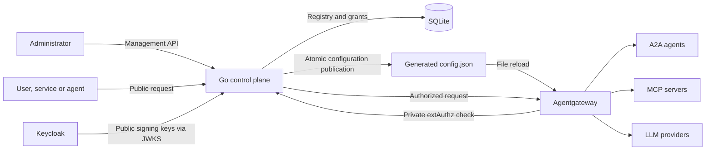

# Architecture and implementation

The platform provides one administration entry point for MCP servers and tools, preserves the original user or service across agent delegation, and authorizes agent, tool and model requests from persistent grants. The Go control plane manages the registry and application authorization. Agentgateway executes the protocol routing and MCP federation.

## Functional components

| Component | Responsibility | Implementation |
|---|---|---|
| Identity provider | Authenticate users, services and agents; issue signed access tokens | Keycloak; Go validates RS256 signatures using its JWKS |
| Public entry point | Validate caller identity, authorize requests, manage the origin reference and forward traffic | Go `PublicHandler`, port 8080 |
| Authorization service | Resolve the original caller and current agent, read current grants, return allowed tools and models | Go `Decide` and private `POST /check`, port 8000 |
| MCP registry | Register server endpoints, discover tools, maintain availability and metadata | Go `MCPRegistry` and SQLite |
| Management API | Update MCP servers/tool groups and LLM groups with separate administrator credentials | Go `/admin/mcp/*` and `/admin/llm/*` |
| Gateway configuration publisher | Combine fixed routing/enforcement with MCP destinations from the registry | Go renders an atomic JSON file from a YAML template |
| Protocol gateway | Route A2A requests, federate MCP targets, filter tool discovery/invocation, proxy LLM requests | Agentgateway, private ports 8080 and 8081 |
| Persistent registry and grants | Store identities, resources, memberships, permissions and hashed origin references | SQLite through `modernc.org/sqlite` |
| Schema migration runner | Apply versioned SQL and one-time demonstration initialization before serving requests | Separate `authorizer migrate` command / Compose `migrate` service |

The protocol gateway does not query SQLite directly. It calls the Go authorization service and consumes the generated destination configuration. Application authorization is implemented in Go; there is no separate policy engine deployed in this version.

## Administration and traffic



All example application requests enter through Go, including requests made by agents. This proxy observes root completion and closes the origin reference before the root response headers reach the external caller. Registry administration does not replace this lifecycle function.

Go also implements the authorization decision invoked by agentgateway. The public check rejects invalid requests before forwarding; the gateway check supplies trusted metadata for native MCP enforcement. These are two calls to the same Go decision logic, not independent policy definitions.

`GET /llm/v1/models` is an exception to forwarding: Go returns the authorized model aliases directly from SQLite. It does not fetch a provider's complete model catalog.

## MCP server registration and discovery

1. An administrator calls `PUT /admin/mcp/servers/{id}` with an HTTP(S) Streamable HTTP endpoint and an optional `enabled` flag. PUT replaces these settings; an omitted flag means enabled.
2. Go persists the destination and publishes the updated gateway configuration. Registering a destination grants no caller access.
3. The administrator calls `POST /admin/mcp/servers/{id}/sync`.
4. Go uses the official MCP Go SDK to initialize a session and retrieve all `tools/list` pages. It closes the discovery session afterwards. It does not invoke tools.
5. After successful discovery, Go atomically refreshes the catalog. Existing tool IDs, explicit disables and group memberships survive. New tools have no memberships; absent tools become unavailable. A failed discovery leaves the previous catalog unchanged.
6. The administrator assigns selected numeric tool IDs and principals through `PUT /admin/mcp/groups/{group}`.
7. Agents and services use the aggregated `/mcp/` endpoint. Agentgateway obtains tool descriptions from the upstream MCP servers; the registry's saved definition is for administration, not a replacement MCP server response.

The public tool name is `{server_id}_{tool_name}`, for example `finance_get_invoice`. The registry stores `finance` and `get_invoice` separately. Changing a server endpoint makes its current tools unavailable and clears its discovery timestamp until a successful synchronization. Disabling a server denies all its tools without deleting memberships. Deleting a server removes its tools and their memberships; it leaves the containing group definitions in place.

The registry supports HTTP(S) Streamable HTTP endpoints without upstream authentication. It rejects endpoint URLs with embedded credentials, query strings, fragments or environment expansion. Server IDs contain letters, digits and hyphens, with a maximum of 64 characters. Periodic synchronization, upstream OAuth, secret management, stdio and legacy SSE transports are not exposed by this management API.

## Configuration publication

| Input or output | Role |
|---|---|
| `gateway/config.yaml` | Trusted template containing fixed A2A routes, LLM provider mappings, external authorization, native tool filtering and header policies |
| `mcp_servers` in SQLite | Authoritative list of MCP destinations and their enabled state |
| `authorization/data/gateway/config.json` | Ignored generated runtime file on the host |
| `/etc/agentgateway/config.json` | Same generated file mounted into the gateway container |

At startup, after server registration/update/deletion, and on `POST /admin/mcp/apply`, Go reads the template and replaces the target list of the named `mcp` route with enabled registry entries sorted by ID. It preserves the other template sections. Publication writes a temporary file, flushes it and atomically renames it. Identical output is not rewritten.

Compose mounts the generated **directory**, read-only for agentgateway. This permits file replacement to become visible inside the container. `make env` creates the directory as the invoking user before Docker mounts it. The gateway starts after the authorizer is healthy and reloads the generated configuration when it changes. File reload was exercised by the integration test that registers, discovers, grants and invokes an additional MCP destination without a restart. Upstream explains the [configuration reload architecture](https://github.com/agentgateway/agentgateway/blob/v1.6.0/architecture/configuration.md).

`published` acknowledges successful file publication, not successful runtime reload. SQLite and the filesystem are not one transaction. If publication fails after a registry update, the API returns 503 and explicitly states that the DB change was saved. Correct the failure and call `apply`; startup also regenerates the file. Revocation through server disables/removals remains enforced by Go while routing catches up. Endpoint replacement and a subsequent sync are separate operations; there is no transactional cutover acknowledgement from agentgateway.

MCP destinations must not be independently edited in the generated file or through another configuration writer. Fixed A2A routes and LLM provider routing still come from the template; changing `agents.endpoint` or adding an LLM alias in SQLite does not generate those routes. Template changes require `apply` or an authorizer restart.

## Delegated execution and reference lifecycle

```mermaid
sequenceDiagram
    participant User as User or service
    participant Go as Go control plane
    participant Gateway as Agentgateway
    participant Agent as Acting agent
    participant MCP as MCP server
    User->>Go: Own JWT and A2A message/send
    Go->>Go: Validate identity and agent grant; create reference
    Go->>Gateway: Root request with reference and workflow
    Gateway->>Go: extAuthz /check
    Gateway->>Agent: Authorized root request
    Agent->>Go: Own agent JWT, reference, workflow, tools/list
    Go->>Gateway: Authorized discovery request
    Gateway->>Go: extAuthz /check returns allowed_tools
    Gateway-->>Agent: Filtered tool catalog through Go
    Agent->>Go: Own JWT, reference, workflow, tools/call
    Go->>Gateway: Authorized invocation
    Gateway->>Go: extAuthz /check
    Gateway->>MCP: Allowed tool call; caller JWT and reference removed
    MCP-->>Agent: Tool result through Gateway and Go
    Agent-->>Go: Root response through Gateway
    Go->>Go: Revoke reference before releasing response headers
    Go-->>User: Final response without reference
```

Keycloak issues the identity JWT. Go issues a separate random 256-bit origin reference, not another JWT. Only its SHA-256 hash is stored. An external user/service cannot supply this reference; Go creates it after authorizing a root A2A request. Agents pass it with their own JWT and the workflow ID. A workflow ID by itself grants no authority.

Each use checks the stored origin, workflow, expiration, revocation and process owner, plus a local active-reference fence. References live for at most five minutes and no later than the root JWT expiration. The origin must still be enabled and have direct permission for the acting agent. Revocation happens before root response headers, with deferred cleanup for errors and client cancellation. The local fence denies reuse even when the DB revocation write fails. Startup revokes unfinished references belonging to earlier executions. Previously authorized operations are not cancelled retroactively.

Only synchronous A2A `message/send` is accepted. Asynchronous task lifecycles, streaming LLM calls and multiple Go replicas are outside the current implementation.

## Implementation map

| Path | Implemented responsibility |
|---|---|
| `authorization/main.go` | CLI commands, environment configuration, schema/startup checks, initial configuration publication and HTTP server lifecycle |
| `authorization/identity.go` | JWT/JWKS verification, secure random references and hashing |
| `authorization/server.go` | Shared authorization decisions, public proxy, private extAuthz API, reference lifecycle and model discovery |
| `authorization/store.go` | SQLite connection, migrations and seed ledger, context persistence, resource grant queries |
| `authorization/mcp_registry.go` | Registry APIs, official SDK discovery, tool group administration and configuration rendering/publication |
| `authorization/admin.go` | Administrator authentication and LLM group/model management |
| `authorization/migrations/*.sql` | Versioned application schema, including MCP availability and metadata |
| `authorization/*_test.go` | Go tests for authorization, identity, lifecycle, migrations, catalog synchronization and management atomicity |
| `gateway/config.yaml` | Fixed gateway routing/enforcement template with an empty managed MCP target list |
| `gateway/Dockerfile` | Pinned agentgateway image plus container health check |
| `compose.yaml` | Component wiring, ports, mounts, trusted network and startup dependencies |
| `policies/seed.json` | Initial demonstration principals and grants, applied once |
| `scripts/init_env.py` | Independent local admin/check secrets and generated-directory initialization |
| `Makefile` | Setup, build, migration, startup, checks, tests and shutdown |
| `tests/test_gateway.py` | End-to-end tests against the running example, including live gateway reload |

Environment configuration is read by `main.go`:

| Variable | Meaning or default |
|---|---|
| `AUTHZ_DATABASE` | SQLite file, default `/data/permissions.db` |
| `SEED_FILE` | Initial example data for `migrate`, default `/config/seed.json` |
| `OIDC_ISSUER`, `OIDC_AUDIENCE`, `OIDC_JWKS_URL` | Required trusted identity settings |
| `AUTHZ_ADMIN_TOKEN` | Required administrator API secret |
| `AUTHZ_CHECK_TOKEN` | Required gateway-to-authorizer secret |
| `GATEWAY_UPSTREAM` | Private proxy destination, default `http://agentgateway:8080` |
| `GATEWAY_CONFIG_TEMPLATE` | Template path, default `/config/gateway.yaml` |
| `GATEWAY_CONFIG_OUTPUT` | Generated path, default `/data/gateway/config.json` |

## Resilience and circuit breaking

Runtime backend health and eviction belong to agentgateway. Go owns destination administration and authorization, not a second circuit-breaker implementation. **The current template does not enable a `health.eviction` policy**, and the registry API has no circuit-breaker parameter fields. Existing Go timeouts, extAuthz timeouts and Docker health checks do not constitute circuit breaking.

Agentgateway's native eviction can temporarily exclude unhealthy endpoints. When all endpoints are excluded, its load balancer can select excluded endpoints again; eviction therefore does not guarantee a period with no calls to a single failing endpoint. Alternatives mean interchangeable instances of the same backend, not unrelated MCP servers. Finance and Documents in the example provide different operations and cannot replace one another. See [backend health behavior](https://agentgateway.dev/docs/kubernetes/latest/documentation/resiliency/backend-health/).

MCP tool errors can be returned as `isError: true` inside a successful protocol response. A policy based only on HTTP 5xx does not automatically classify those results as backend failures. Configuration and tests would need to distinguish transport failures from legitimate application errors before treating MCP eviction as operationally validated. See the [MCP tool error specification](https://modelcontextprotocol.io/specification/2025-06-18/server/tools#error-handling).

## Related documents

- [Database schema](DATABASE.md)
- [Policy management and evaluation](POLICIES.md)
- [Example deployment](EXAMPLE_ENVIRONMENT.md)
- [Runnable API examples](../CURLS.md)
