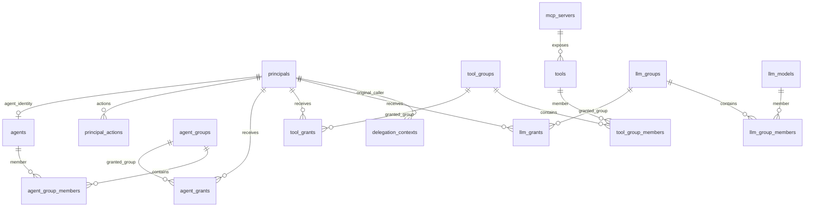

# SQLite database

SQLite is the authoritative registry and application authorization database. The host file is `authorization/data/permissions.db`; the Go container accesses it at `/data/permissions.db`. Agentgateway does not open this database.

The following schema describes the four SQL migration scripts in `authorization/migrations/` plus the migration ledger created by the migration runner. It contains **17 application/administrative tables**; SQLite internal tables are not part of this count. SQL migrations are authoritative for exact constraints and nullability.

## Identities and callable agents

| Table | Columns | Purpose and constraints |
|---|---|---|
| `principals` | `id TEXT`, `kind TEXT`, `role TEXT`, `domain TEXT`, `enabled INTEGER` | `id` is the primary key. `kind` is `user`, `service` or `agent`. `enabled` defaults to 1 and accepts 0/1. `role` and `domain` are required descriptive metadata; they do not select permissions. |
| `principal_actions` | `principal_id TEXT`, `action TEXT` | Composite primary key; `principal_id` references `principals.id`. `action` is one of `a2a.invoke`, `tools.read`, `tools.execute`, `llm.read`, `llm.invoke`. Enables operation categories separately from resource grants. |
| `agents` | `id TEXT`, `endpoint TEXT` | `id` is both primary key and FK to `principals.id`; endpoint is required. Identifies callable agents for grants. Current A2A routing uses the gateway template, not this endpoint column. |

Identity credentials, passwords, JWT signing keys and OAuth client secrets are held by Keycloak or deployment configuration, not these tables. A Keycloak identity also needs an enabled, matching registry principal to use the platform.

## MCP catalog

| Table | Columns | Purpose and constraints |
|---|---|---|
| `mcp_servers` | `id TEXT`, `endpoint TEXT`, `enabled INTEGER`, `synced_at INTEGER` | `id` is the primary key. Required endpoint is the source for generated routing. `enabled` defaults to 1 and accepts 0/1. `synced_at` is nullable Unix seconds for the last successful discovery; endpoint replacement clears it. |
| `tools` | `id INTEGER`, `server_id TEXT`, `name TEXT`, `enabled INTEGER`, `available INTEGER`, `definition TEXT` | Numeric primary key; required `server_id` references `mcp_servers.id`; `(server_id,name)` is unique. `enabled` and `available` default to 1 and accept 0/1. `definition` is JSON text, default `{}`. |

`enabled` expresses the administrator's decision. `available` expresses the last complete discovery result. Effective access requires both flags and the server's enabled flag. A sync updates availability and the saved MCP definition but preserves explicit disables, numeric IDs and existing memberships. Missing tools remain as unavailable rows, retaining their identity and assignments. A later reappearance restores availability, not an explicit disable.

Successful discovery serializes the MCP tool definition, including its name, description and input/output schema when supplied. Before discovery, seeded tool rows have `definition='{}'` and can have `available=1` while `synced_at` is NULL. The seed bootstraps the example; a timestamp is not itself an authorization requirement. Newly discovered rows have no group memberships.

Deleting a server through the API explicitly deletes its tool-group memberships, tools and server row in one transaction. It does not delete group definitions or grants to those groups. Endpoint replacement invalidates the old catalog until a successful sync.

## Agent and tool groups

| Table | Columns | Purpose and constraints |
|---|---|---|
| `agent_groups` | `id TEXT` | Primary key identifying a set of callable agents. |
| `agent_group_members` | `group_id TEXT`, `agent_id TEXT` | Composite primary key; references `agent_groups.id` and `agents.id`. Defines group contents. |
| `agent_grants` | `principal_id TEXT`, `group_id TEXT` | Composite primary key; references `principals.id` and `agent_groups.id`. Gives a principal access to the group's agents. |
| `tool_groups` | `id TEXT` | Primary key identifying a set of tools, potentially from several MCP servers. |
| `tool_group_members` | `group_id TEXT`, `tool_id INTEGER` | Composite primary key; references `tool_groups.id` and `tools.id`. Defines group contents. |
| `tool_grants` | `principal_id TEXT`, `group_id TEXT` | Composite primary key; references `principals.id` and `tool_groups.id`. Gives a principal access to the group's tools. |

Groups here contain resources, not users. A user, service or agent receives a group grant through its principal ID. Multiple granted groups contribute a union of resources. The agent/tool association tables retain the original migration's nullable FK columns; management APIs populate explicit non-null IDs and foreign keys enforce referenced resources. Application group deletion explicitly removes memberships and grants because these FKs do not use cascading deletion.

## Model groups

| Table | Columns | Purpose and constraints |
|---|---|---|
| `llm_models` | `id TEXT`, `enabled INTEGER` | Primary key is the public model alias, such as `standard`. Enabled defaults to 1 and accepts 0/1. |
| `llm_groups` | `id TEXT` | Primary key identifying a model group. |
| `llm_group_members` | `group_id TEXT`, `model_id TEXT` | Required FKs to `llm_groups.id` and `llm_models.id`; composite primary key. Group deletion cascades. |
| `llm_grants` | `principal_id TEXT`, `group_id TEXT` | Required FKs to `principals.id` and `llm_groups.id`; composite primary key. Group deletion cascades. |

The catalog stores aliases and permissions, not provider URLs, API keys or routing/failover configuration. Provider mappings come from the gateway template. Registering a DB alias alone does not create a working provider route, and a gateway route alone does not grant access.

## Origin references and schema ledger

| Table | Columns | Purpose and constraints |
|---|---|---|
| `delegation_contexts` | `token_hash TEXT`, `origin_id TEXT`, `workflow_id TEXT`, `owner TEXT`, `created_at INTEGER`, `expires_at INTEGER`, `revoked_at INTEGER` | SHA-256 hash is the primary key. Required origin FK to `principals.id`; workflow and process owner are required. Times are Unix seconds; `revoked_at` is nullable. The `delegation_workflow` index covers `workflow_id`. |
| `authz_schema_migrations` | `version TEXT` | Primary key records applied migration filenames and one-time seed markers. Created explicitly by the migration runner. |

The raw origin reference is never persisted. `owner` identifies a Go process instance; it is not an agent ID. A reference must also be present in that process's active-reference map. Startup revokes unfinished references, and expired rows are cleaned up when a new context is created. The workflow column is a correlation identifier, not a complete call-chain/event history. The same workflow ID can appear on different root contexts.

The ledger records `001_permissions.sql`, `002_contexts_llm.sql`, `003_actions.sql`, `004_mcp_registry.sql`, `seed-v1` and `seed-actions-v1` after successful initialization.

## Relationships

The diagram shows intended application associations; exact SQL nullability remains defined by the migrations. The independent migration ledger has no FK relationships.

## Migrations and initialization

| Step | Effect |
|---|---|
| `001_permissions.sql` | Principals, agent/MCP catalogs, resource groups, memberships and grants |
| `002_contexts_llm.sql` | Origin references, workflow index, LLM catalog and groups |
| `003_actions.sql` | Separate operation permissions |
| `004_mcp_registry.sql` | Server enablement/discovery timestamp and tool availability/definition |
| `seed-v1` | Initial demonstration identities, catalogs and resource grants, with legacy database adoption |
| `seed-actions-v1` | Initial action grants and example-specific overrides |

Run `make migrate` or let `make up` run the separate migration container. Each SQL migration runs in a transaction and is recorded only on success. Normal serving checks the expected ledger and does not create tables. Repeated migration/startup does not reconcile the seed or restore revoked permissions. Editing `policies/seed.json` is not a way to update an initialized deployment.

## Transaction and storage behavior

Go enables SQLite foreign keys, uses one database connection and configures a 1-second busy timeout. Authorization reads for a decision share a read transaction. Tool discovery completes all upstream pages before beginning its catalog write transaction. Group replacement is atomic: invalid resource/principal IDs or duplicate assignments roll back the previous group's replacement.

Database unavailability denies execution; it is not treated as permission to bypass authorization. The runtime file is separately published, so file/DB failures do not form a single distributed transaction. See [configuration publication](ARCHITECTURE.md#configuration-publication).

There are no DB tables for provider secrets, gateway health/eviction state, generic policy documents, user groups or use cases in this version. The SQL schema models the authorization described in [Policy management](POLICIES.md).
